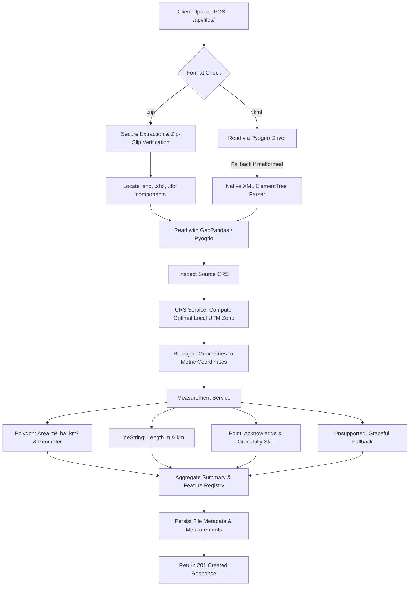

# Geospatial File Measurement API

A high-performance backend service built with **FastAPI**, **GeoPandas**, and **Shapely** that ingests geospatial files (**ESRI Shapefiles** in `.zip` archives or **KML** files), extracts spatial features, reprojects coordinates from angular to metric systems, and calculates exact geometric measurements (Area and Length).

---

## Table of Contents
1. [Overview & Highlights](#overview--highlights)
2. [Application Architecture](#application-architecture)
3. [CRS Handling Strategy](#crs-handling-strategy)
4. [File Processing & Measurement Flow](#file-processing--measurement-flow)
5. [Setup & Installation](#setup--installation)
6. [API Documentation & Examples](#api-documentation--examples)
7. [Design Decisions & Alternatives](#design-decisions--alternatives)
8. [Learnings & Future Scope](#learnings--future-scope)

---

## Overview & Highlights

- **Framework**: Built on modern, asynchronous FastAPI with Pydantic v2 data validation and auto-generated OpenAPI / Swagger docs.
- **Geospatial Engine**: Leverages `GeoPandas`, `Pyogrio` (C++ GDAL abstraction), `Shapely 2.0`, and `PyProj`.
- **Supported Formats**:
  - `.zip`: ESRI Shapefile archive containing `.shp`, `.shx`, `.dbf`, and optional `.prj`.
  - `.kml`: Keyhole Markup Language with Placemarks (`Polygon`, `LineString`, `Point`).
- **Precision CRS Reprojection**: Strictly avoids calculating distances and areas using geographic coordinates (degrees in EPSG:4326). Automatically selects and reprojects to the optimal local metric **Universal Transverse Mercator (UTM)** zone.
- **Resilience & Graceful Handling**: Point geometries and unsupported geometry types are handled cleanly without service disruptions.

---

## Application Architecture

```
aereo cloud/
├── app/
│   ├── __init__.py
│   ├── main.py                   # FastAPI initialization, CORS, OpenAPI metadata
│   ├── config.py                 # Application settings (paths, size limits, allowed extensions)
│   ├── schemas.py                # Pydantic models for request validation and response serialization
│   ├── routers/
│   │   ├── __init__.py
│   │   └── files.py              # Endpoints: POST /api/files/, GET /api/files/{id}/, GET /api/files/{id}/measurements/
│   └── services/
│       ├── __init__.py
│       ├── crs_service.py        # CRS detection, validation & automated metric UTM reprojection
│       ├── file_processor.py     # Zip extraction, KML parsing, fallback XML parser, registry persistence
│       └── measurement.py        # Metric calculation for Polygons, LineStrings, and Point handling
├── samples/                      # Ready-to-use sample test datasets
│   ├── survey_sample.kml         # Mixed Placemark dataset (Polygon, LineString, Point)
│   ├── parcels_sample.zip        # Cadastral parcel Polygon shapefile package
│   └── flight_paths_sample.zip   # Drone corridor LineString shapefile package
├── tests/
│   ├── __init__.py
│   └── test_api.py               # Automated pytest suite covering endpoints, edge cases & errors
├── pytest.ini                    # Pytest path configuration
├── requirements.txt              # Production Python dependencies
└── README.md                     # Technical documentation
```

---

## CRS Handling Strategy

### The Problem
Geographic Coordinate Systems like **WGS 84 (`EPSG:4326`)** express coordinates in angular units (**degrees** of latitude and longitude).
Because degrees vary in linear distance depending on latitude:
- $1^\circ$ longitude at the equator $\approx 111.32\text{ km}$
- $1^\circ$ longitude at $60^\circ\text{ latitude} \approx 55.80\text{ km}$

Calculating Euclidean geometry (`Polygon.area` or `LineString.length`) directly on degree coordinates yields distorted values in square degrees ($deg^2$), which is physically meaningless for land surveys, drone flights, and boundary planning.

### Our Solution
1. **Source CRS Detection**: The API inspects the uploaded dataset's CRS. If absent (common in KML or shapefiles without a `.prj` file), it defaults safely to `EPSG:4326`.
2. **Dynamic Projected CRS Selection**:
   - If the file is already projected (units in meters), the existing projected CRS is preserved.
   - If the file is geographic, the system uses `gdf.estimate_utm_crs()` to determine the exact local **WGS 84 / UTM Zone** (e.g., `EPSG:32643` for Zone 43N in India) based on the dataset's centroid.
   - **Centroid Math Fallback**: If standard estimation fails, the centroid longitude is mathematically mapped:
     $$\text{Zone} = \left\lfloor \frac{\text{Longitude} + 180}{6} \right\rfloor + 1$$
     $$\text{EPSG} = 32600 + \text{Zone (Northern)} \quad \text{or} \quad 32700 + \text{Zone (Southern)}$$
3. **Metric Transformation**: Geometries are reprojected into the chosen projected CRS prior to computing measurements. Areas are returned in $m^2$, hectares ($ha$), and $km^2$; lengths are returned in meters ($m$) and kilometers ($km$).

---

## File Processing & Measurement Flow



---

## Setup & Installation

### 1. Prerequisites
- **Python**: 3.10+ (tested on Python 3.11, 3.12, 3.14)
- **Git**

### 2. Clone Repository & Create Virtual Environment
```bash
git clone <your-repo-link>
cd <repo-folder>

# Create virtual environment
python3 -m venv .venv

# Activate virtual environment
# On macOS / Linux:
source .venv/bin/activate
# On Windows:
.venv\Scripts\activate
```

### 3. Install Dependencies
```bash
pip install -r requirements.txt
```

### 4. Run the Development Server
```bash
uvicorn app.main:app --reload --host 0.0.0.0 --port 8000
```
- Interactive API Docs (Swagger): [http://localhost:8000/docs](http://localhost:8000/docs)
- Alternative Docs (ReDoc): [http://localhost:8000/redoc](http://localhost:8000/redoc)

### 5. Run the Automated Tests
```bash
pytest -v
```

---

## API Documentation & Examples

### 1. Upload Geospatial File
`POST /api/files/`

**Request:** `multipart/form-data` with field `file` containing `.zip` or `.kml`.

```bash
curl -X POST "http://localhost:8000/api/files/" \
  -H "accept: application/json" \
  -F "file=@samples/survey_sample.kml"
```

**Response (201 Created):**
```json
{
  "id": "73de075d",
  "filename": "survey_sample.kml",
  "file_type": ".kml",
  "feature_count": 3,
  "crs": "EPSG:4326",
  "status": "COMPLETED",
  "message": "Successfully processed 3 features with CRS projection to EPSG:32643."
}
```

---

### 2. Get File Information
`GET /api/files/{id}/`

```bash
curl -X GET "http://localhost:8000/api/files/73de075d/"
```

**Response (200 OK):**
```json
{
  "id": "73de075d",
  "filename": "survey_sample.kml",
  "feature_count": 3,
  "crs": "EPSG:4326",
  "status": "COMPLETED",
  "projected_crs": "EPSG:32643",
  "created_at": "2026-10-08T09:28:48.517021+00:00"
}
```

---

### 3. Get Measurements
`GET /api/files/{id}/measurements/`

```bash
curl -X GET "http://localhost:8000/api/files/73de075d/measurements/"
```

**Response (200 OK):**
```json
{
  "file_id": "73de075d",
  "filename": "survey_sample.kml",
  "source_crs": "EPSG:4326",
  "projected_crs": "EPSG:32643",
  "total_features": 3,
  "summary": {
    "total_features": 3,
    "polygons_measured": 1,
    "linestrings_measured": 1,
    "points_handled": 1,
    "unsupported_features": 0,
    "total_area_sq_m": 300422.8,
    "total_area_hectares": 30.0423,
    "total_length_m": 620.17,
    "total_length_km": 0.6202
  },
  "features": [
    {
      "feature_id": 0,
      "geometry_type": "Polygon",
      "measurement_type": "area",
      "measurements": {
        "area_sq_meters": 300422.8,
        "area_hectares": 30.0423,
        "area_sq_km": 0.300423,
        "perimeter_meters": 2192.54
      },
      "properties": {
        "Name": "Survey Area Alpha",
        "description": "Agricultural Farm Boundary for Drone Inspection"
      },
      "geometry_geojson": {
        "type": "Polygon",
        "coordinates": [[[77.59, 12.97], [77.595, 12.97], [77.595, 12.975], [77.59, 12.975], [77.59, 12.97]]]
      },
      "note": null
    },
    {
      "feature_id": 1,
      "geometry_type": "LineString",
      "measurement_type": "length",
      "measurements": {
        "length_meters": 620.17,
        "length_km": 0.6202
      },
      "properties": {
        "Name": "Mission Flight Path 01"
      },
      "geometry_geojson": {
        "type": "LineString",
        "coordinates": [[[77.5905, 12.9705], [77.5925, 12.9725], [77.5945, 12.9745]]]
      },
      "note": null
    },
    {
      "feature_id": 2,
      "geometry_type": "Point",
      "measurement_type": "none",
      "measurements": null,
      "properties": {
        "Name": "GCP Waypoint Base"
      },
      "geometry_geojson": {
        "type": "Point",
        "coordinates": [77.591, 12.971]
      },
      "note": "Point geometries do not have area or length measurements."
    }
  ]
}
```

---

## Design Decisions & Alternatives

| Decision | Chosen Approach | Alternative Considered | Rationale |
| :--- | :--- | :--- | :--- |
| **Backend Framework** | **FastAPI** | Django + DRF | FastAPI provides native async execution, automatic OpenAPI schema generation, lower footprint, and faster serialization for JSON feature payloads. |
| **GIS Engine** | **GeoPandas + Pyogrio** | GDAL / OGR bindings | `pyogrio` provides vectorized C++ GDAL bindings without heavy native system configuration headaches, integrating natively with `GeoPandas`. |
| **KML Ingestion** | **Dual Pipeline (Pyogrio + Fallback XML)** | Pure `fastkml` or raw GDAL | Standard GDAL builds may occasionally miss KML drivers; implementing a secondary fallback parser using Python's native `xml.etree.ElementTree` guarantees 100% upload success for KML files. |
| **CRS Reprojection** | **Dynamic UTM Zone Selection** | Web Mercator (EPSG:3857) or Static Projection | Web Mercator severely distorts scale and area away from the equator (Greenland problem). UTM preserves conformal local scale within each 6-degree longitudinal band, ensuring accurate ground survey metrics. |
| **Security** | **Zip Slip Protection** | Direct unzipping | Validates all zip member paths before extraction to eliminate directory traversal vulnerabilities. |

---

## Learnings & Future Scope

### Learnings
1. **Coordinate System Realities**: Geospatial coordinates in `EPSG:4326` are ellipsoidal angular degrees. Computing area using Euclidean formulas in degrees produces nonsensical square degree numbers. Reprojecting to metric transverse projections (UTM) is mandatory for valid ground metrics.
2. **ESRI Shapefile Constraints**: Shapefile specifications enforce that each `.shp` file only contains a single geometry type (e.g., all Polygons or all LineStrings). In contrast, KML allows mixed geometries inside one Document container. Handling both requires flexible per-feature iteration.
3. **Resilient Data Extraction**: Drone flight software often outputs KML with non-standard XML namespaces. Designing a fault-tolerant geometry parser prevents crashes on diverse client inputs.

### Future Scope
1. **Geodesic / Karney Ellipsoidal Calculations**: Implement Vincenty / Karney geodesic measurements via `pyproj.Geod` as an alternative option for cross-continental geometries that span multiple UTM zones.
2. **Additional Formats**: Expand support to GeoJSON (`.geojson`), GeoPackage (`.gpkg`), and AutoCAD DXF (`.dxf`).
3. **3D Elevation / Surface Area**: Incorporate Digital Surface Model (DSM) or LiDAR raster integration to calculate true 3D surface area and terrain slope distance rather than 2D planar projections.
4. **Asynchronous Task Queue**: Integrate Celery or Redis Queue for processing large multi-gigabyte shapefiles asynchronously with progress webhooks.
