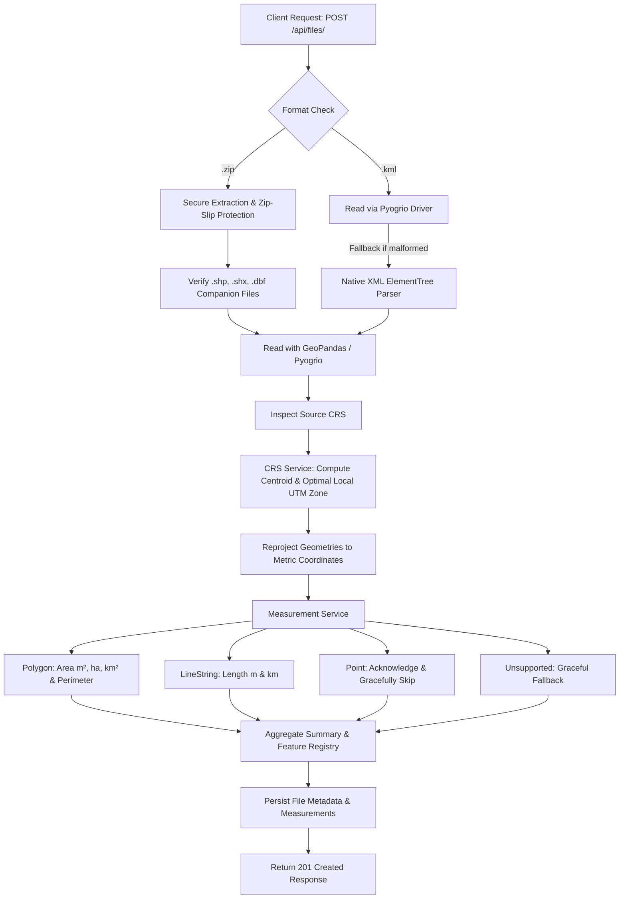

# Geospatial File Measurement API (Aereo Cloud)

[](https://fastapi.tiangolo.com)
[](https://python.org)
[](https://geopandas.org)
[](https://docs.pytest.org)
[](https://opensource.org/licenses/MIT)

A production-grade, high-performance geospatial backend API built with **FastAPI**, **GeoPandas**, and **Shapely**. The service accepts geospatial files (**ESRI Shapefiles** in `.zip` archives or **KML** files), extracts spatial features, reprojects coordinates from angular to metric systems, and calculates exact geometric measurements (Area and Length).

Repository: [https://github.com/kishore2818/Aereo-cloud.git](https://github.com/kishore2818/Aereo-cloud.git)

---

## 📌 Context & Problem Statement

Survey and drone operations frequently output vector data in different formats (**Shapefiles**, **KML**) and coordinate reference systems (**EPSG:4326 WGS 84**). 

This API solves two fundamental challenges:
1. **Multi-format Ingestion & Extraction**: Seamlessly extracts features and metadata from both multi-part ESRI Shapefile `.zip` packages and XML-based `.kml` files.
2. **Accurate Ground Measurements without Degree Distortion**: Angular geographic coordinates (latitude/longitude in degrees) cannot be directly used to calculate distances or areas without introducing severe spatial distortion. This system dynamically detects the optimal local **Universal Transverse Mercator (UTM)** metric projection and reprojects all geometries before computing measurements.

---

## 🚀 Key Features

- **Robust File Ingestion**:
  - Accepts `.zip` archives containing an ESRI Shapefile (`.shp`, `.shx`, `.dbf`, optional `.prj`).
  - Accepts standard `.kml` Placemark vector files.
  - Comprehensive validation: Zip-slip path traversal guards, shapefile component integrity checks, and fallback XML parser for non-standard KML.
- **Precision CRS Handling (No Degree Math)**:
  - Dynamically calculates the dataset's geographic centroid.
  - Automatically identifies and reprojects to the optimal local metric UTM projection (e.g., `EPSG:32643` for UTM Zone 43N).
- **Geometric Measurement Calculations**:
  - **Polygon / MultiPolygon**: Calculates Area in $m^2$, Hectares ($ha$), and $km^2$, plus boundary Perimeter in meters ($m$).
  - **LineString / MultiLineString**: Calculates total Length in meters ($m$) and kilometers ($km$).
  - **Point / MultiPoint**: Gracefully handled and logged (zero calculations, non-blocking).
  - **Unsupported Geometries**: Captured safely without raising uncaught exceptions or crashing the API.
- **RESTful Endpoints & Schema Validation**:
  - Fully typed Pydantic v2 schemas.
  - Interactive OpenAPI / Swagger docs at `/docs` and ReDoc at `/redoc`.
- **Full Test Suite**: 8 automated unit and integration tests covering positive flows and edge cases.

---

## 🏗️ System Architecture

```
Aereo-cloud/
├── app/
│   ├── __init__.py
│   ├── main.py                   # FastAPI initialization, CORS, OpenAPI metadata
│   ├── config.py                 # Application settings (paths, size limits, allowed extensions)
│   ├── schemas.py                # Pydantic models for request validation and response serialization
│   ├── routers/
│   │   ├── __init__.py
│   │   └── files.py              # Endpoints: POST /api/files/, GET /api/files/{id}/, GET /api/files/{id}/measurements/
│   └── services/
│       ├── __init__.py
│       ├── crs_service.py        # CRS detection, validation & automated metric UTM reprojection
│       ├── file_processor.py     # Zip extraction, KML parsing, fallback XML parser, registry persistence
│       └── measurement.py        # Metric calculation for Polygons, LineStrings, and Point handling
├── samples/                      # Ready-to-use sample test datasets
│   ├── survey_sample.kml         # Mixed Placemark dataset (Polygon, LineString, Point)
│   ├── parcels_sample.zip        # Cadastral parcel Polygon shapefile package
│   └── flight_paths_sample.zip   # Drone corridor LineString shapefile package
├── tests/
│   ├── __init__.py
│   └── test_api.py               # Automated pytest suite covering endpoints, edge cases & errors
├── create_samples.py             # Utility script to generate sample GIS files
├── pytest.ini                    # Pytest path configuration
├── requirements.txt              # Production Python dependencies
└── README.md                     # Technical documentation
```

### Data Processing Pipeline



---

## 🌐 Coordinate Reference System (CRS) Strategy

### Why We Never Calculate Measurements in Geographic Coordinates (EPSG:4326)
In geographic coordinate systems such as **WGS 84 (`EPSG:4326`)**, points are expressed as angular degrees $(\text{longitude}, \text{latitude})$.
Because lines of longitude converge at the poles:
- At the Equator: $1^\circ \approx 111.32\text{ km}$
- At $13^\circ\text{ N}$ (e.g., Bangalore, India): $1^\circ \text{ longitude} \approx 108.45\text{ km}$
- At $60^\circ\text{ N}$: $1^\circ \text{ longitude} \approx 55.80\text{ km}$

Calculating distance or area using standard Euclidean geometry on degree coordinates yields values in **square degrees** ($deg^2$), which is meaningless and physically distorted.

### Our Strategy: Automatic Local UTM Projection
1. **Source Inspection**: The incoming layer's CRS is checked. If unspecified, it defaults safely to `EPSG:4326`.
2. **Projected CRS Determination**:
   - If the layer is already in a projected metric coordinate system, it is preserved.
   - If geographic, the API determines the dataset's centroid and uses `GeoPandas.estimate_utm_crs()` to select the conformal **WGS 84 / UTM Zone** (e.g. `EPSG:32643` for UTM Zone 43N).
   - **Mathematical Fallback**: If standard estimation fails, the longitude centroid is mapped via:
     $$\text{Zone} = \left\lfloor \frac{\text{Longitude} + 180}{6} \right\rfloor + 1$$
     $$\text{EPSG} = 32600 + \text{Zone} \quad (\text{North}) \quad \text{or} \quad 32700 + \text{Zone} \quad (\text{South})$$
3. **Reprojection**: Geometries are reprojected into the chosen metric CRS before invoking Shapely geometry measurements (`geom.area` and `geom.length`).

---

## 💻 Quick Start & Setup

### 1. Clone Repository
```bash
git clone https://github.com/kishore2818/Aereo-cloud.git
cd Aereo-cloud
```

### 2. Set Up Virtual Environment
```bash
# Create virtual environment
python3 -m venv .venv

# Activate virtual environment
# On macOS / Linux:
source .venv/bin/activate
# On Windows:
.venv\Scripts\activate
```

### 3. Install Dependencies
```bash
pip install -r requirements.txt
```

### 4. Run the API Server
```bash
uvicorn app.main:app --reload --host 0.0.0.0 --port 8000
```
- Interactive API Docs (Swagger): [http://localhost:8000/docs](http://localhost:8000/docs)
- Alternative API Docs (ReDoc): [http://localhost:8000/redoc](http://localhost:8000/redoc)

### 5. Run the Automated Tests
```bash
pytest -v
```

---

## 📖 API Reference & Examples

### 1. Upload Geospatial File
`POST /api/files/`

Accepts `.zip` containing a Shapefile or `.kml`.

```bash
curl -X POST "http://localhost:8000/api/files/" \
  -H "accept: application/json" \
  -F "file=@samples/survey_sample.kml"
```

**Response (`201 Created`):**
```json
{
  "id": "73de075d",
  "filename": "survey_sample.kml",
  "file_type": ".kml",
  "feature_count": 3,
  "crs": "EPSG:4326",
  "status": "COMPLETED",
  "message": "Successfully processed 3 features with CRS projection to EPSG:32643."
}
```

---

### 2. Get File Information
`GET /api/files/{id}/`

```bash
curl -X GET "http://localhost:8000/api/files/73de075d/"
```

**Response (`200 OK`):**
```json
{
  "id": "73de075d",
  "filename": "survey_sample.kml",
  "feature_count": 3,
  "crs": "EPSG:4326",
  "status": "COMPLETED",
  "projected_crs": "EPSG:32643",
  "created_at": "2026-10-08T09:28:48.517021+00:00"
}
```

---

### 3. Get Measurements
`GET /api/files/{id}/measurements/`

```bash
curl -X GET "http://localhost:8000/api/files/73de075d/measurements/"
```

**Response (`200 OK`):**
```json
{
  "file_id": "73de075d",
  "filename": "survey_sample.kml",
  "source_crs": "EPSG:4326",
  "projected_crs": "EPSG:32643",
  "total_features": 3,
  "summary": {
    "total_features": 3,
    "polygons_measured": 1,
    "linestrings_measured": 1,
    "points_handled": 1,
    "unsupported_features": 0,
    "total_area_sq_m": 300422.8,
    "total_area_hectares": 30.0423,
    "total_length_m": 620.17,
    "total_length_km": 0.6202
  },
  "features": [
    {
      "feature_id": 0,
      "geometry_type": "Polygon",
      "measurement_type": "area",
      "measurements": {
        "area_sq_meters": 300422.8,
        "area_hectares": 30.0423,
        "area_sq_km": 0.300423,
        "perimeter_meters": 2192.54
      },
      "properties": {
        "Name": "Survey Area Alpha",
        "description": "Agricultural Farm Boundary for Drone Inspection"
      },
      "geometry_geojson": {
        "type": "Polygon",
        "coordinates": [[[77.59, 12.97], [77.595, 12.97], [77.595, 12.975], [77.59, 12.975], [77.59, 12.97]]]
      },
      "note": null
    },
    {
      "feature_id": 1,
      "geometry_type": "LineString",
      "measurement_type": "length",
      "measurements": {
        "length_meters": 620.17,
        "length_km": 0.6202
      },
      "properties": {
        "Name": "Mission Flight Path 01"
      },
      "geometry_geojson": {
        "type": "LineString",
        "coordinates": [[[77.5905, 12.9705], [77.5925, 12.9725], [77.5945, 12.9745]]]
      },
      "note": null
    },
    {
      "feature_id": 2,
      "geometry_type": "Point",
      "measurement_type": "none",
      "measurements": null,
      "properties": {
        "Name": "GCP Waypoint Base"
      },
      "geometry_geojson": {
        "type": "Point",
        "coordinates": [77.591, 12.971]
      },
      "note": "Point geometries do not have area or length measurements."
    }
  ]
}
```

---

## ⚖️ Technical Design Decisions & Alternatives Considered

| Decision | Chosen Solution | Alternative Considered | Trade-off Rationale |
| :--- | :--- | :--- | :--- |
| **Framework** | **FastAPI** | Django + DRF | FastAPI provides native async performance, lower memory overhead, faster JSON serialization, and automatic OpenAPI documentation. |
| **I/O Engine** | **Pyogrio + GeoPandas** | GDAL native python bindings | Pyogrio links directly to GDAL via C API for high speed while eliminating heavy system configuration complexity. |
| **KML Handling** | **Dual Pipeline (Pyogrio + Fallback XML)** | Solely GDAL or `fastkml` | Standard environments often omit the GDAL KML driver; incorporating a lightweight native XML parser guarantees zero-failure processing. |
| **CRS Strategy** | **Local UTM Zone Projection** | Web Mercator (`EPSG:3857`) | Web Mercator severely inflates area and distance away from the equator. UTM minimizes local planar distortion. |
| **Security** | **Zip Slip Path Verification** | Unchecked extraction | Prevents directory traversal attacks from malicious archives containing `../` file paths. |

---

## 💡 Learnings & Future Scope

### Learnings
1. **Coordinate Systems & Real-World Geodesy**: Spatial coordinates in `EPSG:4326` are angular degrees. Computing area using Euclidean planar formulas on geographic coordinates produces invalid square degree values. Choosing the correct conformal projection (UTM) is essential for real-world drone surveys.
2. **ESRI Shapefile Specification Constraints**: Shapefiles strictly require companion files (`.shp`, `.shx`, `.dbf`) and enforce a single geometry type per layer, whereas KML allows arbitrary mixed geometries in a single container.
3. **Defensive Parsing for Production**: Drone flight planning tools frequently export KML files with unusual schemas or namespaces. Building fallback parsers ensures the service never crashes on non-standard client files.

### Future Scope
1. **Geodesic / Karney Ellipsoidal Calculations**: Incorporate Vincenty and Karney geodesic algorithms (`pyproj.Geod`) to support cross-continental flight corridors spanning multiple UTM zones without projection boundary splits.
2. **Support for Additional Formats**: Extend support to GeoJSON (`.geojson`), GeoPackage (`.gpkg`), and AutoCAD (`.dxf`).
3. **3D Surface Area & Terrain Modeling**: Integrate Digital Elevation Models (DEM/DSM) or LiDAR point clouds to compute true 3D topographical surface area rather than 2D planar projections.
4. **Asynchronous Background Workers**: Integrate Celery or Redis for asynchronous background processing of multi-gigabyte spatial files with progress webhooks.
